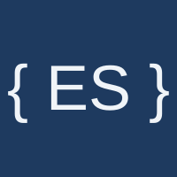

<div align="center">

<p>
  
  &nbsp;&nbsp;<b>+</b>&nbsp;&nbsp;
  
</p>

<p>
  <a href="https://pkg.go.dev/github.com/everscribe/sdk-go"></a>
  <a href="LICENSE"></a>
</p>

# everscribe/sdk-go

Go SDK for the [Everscribe](https://everscribe.io) API. It exposes **middleware**
that records an audit event per request, a **recorder** for writing append-only
audit events directly, and a **minter** for issuing short-lived browser tokens
for [embeddable components](https://github.com/everscribe/components).

</div>

## 📖 Setup Documentation

| Setup link | What it is | Pick it when |
|---|---|---|
| [BYOK Claude Code skill](https://everscribe.io/docs/quickstart/skill) | Install the [`es` CLI](https://github.com/everscribe/cli) and run `es skills download setup`. That drops a skill into your Claude Code skills directory, and your own local Claude agent does the setup. It runs against your Anthropic key, and your source never leaves your machine. | You already use Claude Code and want the agent to do the wiring. |
| [Wire it up yourself](https://everscribe.io/docs/sdks/go-install) | Install the SDK and add the calls by hand. | You want full control, or you are instrumenting a small surface. |

## Supported frameworks

- `net/http`
- `chi`
- `gorilla/mux`
- `gin`
- `echo v4`
- `fiber v3`

> [!NOTE]
> Interceptors available for gRPC servers.

Your framework missing? [Open an issue](https://github.com/everscribe/sdk-go/issues).

## What happens when delivery fails

**Writing.** `Record` only puts the event on an in-memory buffer. It never waits on the network.

**Outage.** A background worker sends batches. Network errors, timeouts, `429` and `5xx` responses are retried with jittered exponential backoff, starting at 500ms and capped at 30s per wait (a server `Retry-After` is honored, up to that cap). A batch is retried for up to 5 minutes. After that its events are dropped as `retries_exhausted`. Tune this with `WithInitialBackoff`, `WithMaxBackoff` and `WithMaxRetryDuration`.

**Rejected events.** If the server answers `400`, `409` or `413` for a batch of several events, the recorder splits the batch in half and retries each half, so one bad event does not take down its neighbors. Splitting is limited to 32 sends per batch. A single event the server rejects, or one that exhausts that budget, is dropped as `rejected`. Any other non-retryable error (401, 403, 404 and other 4xx) drops the whole batch as `rejected` without splitting. A metadata value `json.Marshal` cannot encode (NaN, infinities, channels, funcs) is handled the same way: that event is dropped as `rejected` and the rest of the batch is delivered.

**Buffer full.** The overflow policy decides. `PolicyDropNewest` (the default) discards the new event and counts it, `PolicyBlock` makes `Record` wait for space, and `PolicyError` returns `ErrBufferFull`.

**Knowing about drops.** Pass `WithOnDrop` to hear about every discarded event:

```go
rec := recorder.New(projectID, apiKey,
    recorder.WithOnDrop(func(events []event.Event, reason recorder.DropReason, err error) {
        log.Printf("everscribe: dropped %d events (%s): %v", len(events), reason, err)
    }),
)
```

The reason is one of:

| Reason | Meaning |
|---|---|
| `buffer_full` | The buffer had no room: drop-newest, or the middleware's own record hit a `PolicyBlock`/`PolicyError` overflow. |
| `rejected` | The server refused the event for good, or the split budget ran out. |
| `retries_exhausted` | `MaxRetryDuration` elapsed while the server or network kept failing. |
| `shutdown` | `Close` hit its drain timeout with events still pending. |
| `closed` | The event was recorded after `Close`, or was waiting for buffer space under `PolicyBlock` when `Close` ran. |

`err` is the last delivery error for `rejected` and `retries_exhausted`, the overflow error (`ErrBufferFull`, or the context error under `PolicyBlock`) for a `buffer_full` drop reported from the middleware's own record, and nil otherwise. The callback may be called concurrently from multiple goroutines (`buffer_full` and `closed` on the goroutine that called `Record`, the rest on the background worker or the goroutine calling `Close`), so it must be safe for concurrent use. It must not block and must not call `Record`, `Flush` or `Close` on the same recorder. A dropped event may in fact have been delivered (for example, the response was lost), so re-sending it with its original ID is safe: duplicates are deduplicated. `Stats().DroppedByReason` and `Stats().Retries` expose the same information as counters. `Stats().Dropped` counts only `buffer_full` drops.

**Always call `Close`.** `Close` drains the buffer, retrying as needed, for up to the drain timeout (30s by default). At the timeout it cancels the in-flight send and reports what is left as `shutdown`. A custom inner recorder must honor context cancellation: if it ignores it, `Close` gives up after a further 1s grace and returns, and a late `shutdown` report for the in-flight batch can arrive after it returns. Calling `Close` again waits for the first call to finish and returns its result.

**Always give `Flush` a deadline.** `Flush` returns `nil` once the events queued at the time of the call are delivered or reported to `onDrop`, and `ctx.Err()` if your context ends first. It does not return delivery errors, and ending your context never cancels a send. Retries during an outage can take minutes, so use `context.WithTimeout`.

**Middleware.** If a handler records the request event through a different `BufferedRecorder` than the one the middleware uses, a final drop of that event is reported by the middleware's recorder. If the buffer is full when a handler records the request event, the middleware retries it when the request ends, but only if the event still has an `Action`: a handler that clears `Action` after recording loses that retry and the drop is never reported. Name an event before recording it and don't clear `Action` afterward.

**Your data once it arrives.** Delivered events are immutable, and you can export them as CSV or JSON or forward them to your SIEM. Events that never arrive cannot be recovered, so route `onDrop` to your own logs or queue.

## Additional resources

- [Runnable examples](https://github.com/everscribe/examples): full-stack runnable
apps for every Everscribe SDK.

- [AI-assisted setup demo](https://github.com/everscribe/ai-assisted-setup-demo): Sample repo for trying AI setup against something disposable.

- [Everscribe CLI](https://github.com/everscribe/cli): CLI for downloading the Claude skill and managing projects, API keys, events and more.

- [Embeddable components](https://github.com/everscribe/components): drop-in audit
trail UI for single and multi-tenant apps.
